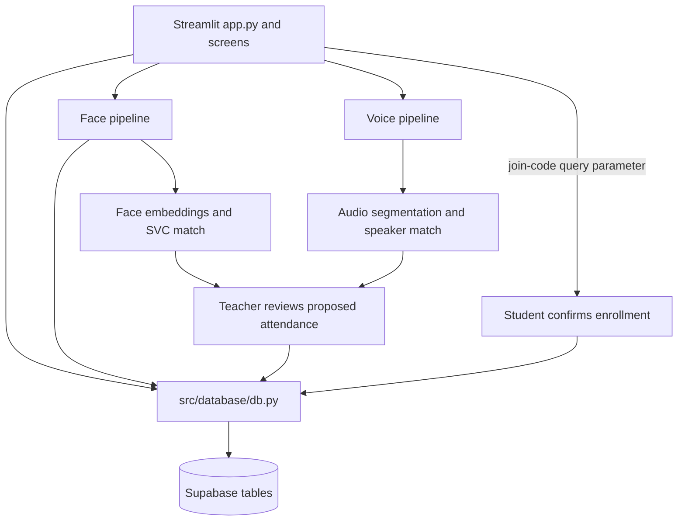

# SnapClass

SnapClass is a Streamlit attendance application for small classes. It lets teachers create subjects, enroll students by subject code, and review attendance proposals generated from classroom photos or recorded speech. Students create a profile using a face image and can optionally add a voice profile; they can then view enrolled subjects and recorded attendance.

**Live demo:** [https://snapclass-bymohak.streamlit.app/](https://snapclass-bymohak.streamlit.app/)

**Repository:** [https://github.com/mohakbh10/snapclass](https://github.com/mohakbh10/snapclass)

## Features

### Student

- Create a profile from a camera image and sign in later through face matching.
- Optionally record a voice sample during profile creation.
- Enroll in a subject with its code or open a teacher's QR/link and confirm enrollment.
- View enrolled subjects and attendance totals; unenroll from a subject.

### Teacher

- Register and sign in with a username and password.
- Create subjects with a code, name, and section; share an enrollment link and QR code.
- Capture or upload classroom photos, inspect a face-recognition attendance proposal, then confirm or discard it.
- Record classroom speech, inspect a voice-recognition attendance proposal, then confirm or discard it.
- View attendance history grouped into class sessions.

Attendance is proposed for teacher review before saving. The implementation does not provide identity verification, anti-spoofing, or an automatic guarantee that a detected person was physically present.

## Technology

- Python and Streamlit for the web interface and session state.
- Supabase's Python client for database access.
- bcrypt for teacher password hashing.
- dlib and `face_recognition_models` for face detection, landmarks, and 128-dimensional face embeddings; scikit-learn's SVC classifies those embeddings.
- Resemblyzer and librosa for voice embeddings and silence-based audio segmentation.
- NumPy, pandas, Pillow, and Segno for numerical work, attendance tables, image handling, and QR generation.

Dependencies are listed in [`requirements.txt`](requirements.txt). They are not version-pinned, so dependency upgrades may change behavior or platform compatibility.

## Architecture and data flow



`app.py` selects the home, teacher, or student screen from Streamlit session state. Screen and dialog modules call the database helpers or recognition pipelines. The face classifier fetches student embeddings from Supabase; the voice attendance dialog fetches profiles for students enrolled in the selected subject. Confirmed attendance rows are inserted into Supabase. Images and recorded audio are processed in the current Streamlit session; the code persists the generated embeddings and attendance rows, not the source media.

The share dialog builds a root URL with the `join-code` query parameter. `app.py` reads that same parameter, switches to the student screen, and opens quick enrollment after student sign-in.

## Recognition pipelines

### Face

The face pipeline loads dlib's frontal-face detector, shape predictor, and face-recognition model once using Streamlit's resource cache. It computes a 128-dimensional descriptor for each detected face. It reads saved face descriptors from the `students` table and fits `SVC(kernel="linear", probability=True, class_weight="balanced")` when there are at least two profile classes. The SVC predicts a student ID; its probability output is not used. A separate Euclidean-distance gate compares the face descriptor with the **first stored descriptor for the predicted student ID** and accepts distances at or below **0.6**. With a single registered profile, the code bypasses SVC prediction, assigns that profile's ID, and still applies the distance gate.

The threshold is a fixed implementation value, not a calibrated confidence or a validated security boundary. A classroom photo can identify more than one face, and the teacher UI records a matching enrolled student as present. Student sign-in separately requires exactly one detected face in its captured image.

### Voice

The voice pipeline loads a cached Resemblyzer encoder, reads audio through librosa at 16 kHz, splits it at detected silences (`top_db=30`), and skips segments shorter than 0.5 seconds. Each remaining segment is compared with voice profiles for students enrolled in the selected subject using cosine similarity. The current acceptance threshold is **0.65**; the best accepted score for each speaker is retained. The UI then presents a roster-wide present/absent proposal for teacher review.

The pipeline reports distinct outcomes for matched speech, usable speech with no speaker match, unusable audio, invalid voice profiles, and analysis failure. Empty recordings, recordings with no qualifying speech segment, analysis failures, or a roster with missing/invalid voice profiles do not produce an attendance proposal. Voice enrollment is optional at profile creation, but every enrolled student needs a valid profile before this voice-attendance workflow can assess the full roster. A successful no-match result does not mark everyone absent: it opens a roster with each student's attendance set to **Needs review**. The teacher must explicitly select Present or Absent for every student before the proposal can be prepared for confirmation.

Voice matching depends on recording quality, segmentation, profile quality, and a fixed threshold. Audio that contains replayed or synthesized speech may be accepted. There is no speaker liveness check, challenge-response phrase verification, calibrated error-rate measurement, or independent identity factor.

## Database shape

There is no SQL file or migration checked into this repository. The following is an **inferred table/field map based on the Supabase queries and inserts in the application**, not a verified schema. Column types, constraints, indexes, foreign keys, and row-level security policies cannot be confirmed from the source tree.

| Table | Fields used by the application |
| --- | --- |
| `teachers` | `teacher_id`, `username`, `password`, `name` |
| `students` | `student_id`, `name`, `face_embedding`, `voice_embedding` |
| `subjects` | `subject_id`, `subject_code`, `name`, `section`, `teacher_id` |
| `subject_students` | `student_id`, `subject_id`; joined to `students` and `subjects` |
| `attendance_logs` | `student_id`, `subject_id`, `timestamp`, `is_present`; joined to `subjects` |

Embedding values are passed to/from Supabase as numeric arrays. The application expects the Supabase relationships used in its nested selects to be configured in the remote database. Before using the project with real student data, verify foreign keys, uniqueness constraints (especially subject codes and student-subject pairs), and restrictive row-level security policies in that database.

## Repository layout

```text
app.py                          Streamlit entry point and session/query routing
requirements.txt                Python dependencies
src/
  components/                   Streamlit dialogs, headers, cards, and footer
  database/config.py            Supabase client configuration
  database/db.py                Supabase reads and writes, password helpers
  pipelines/                    Face and voice recognition
  screens/                      Home, student, and teacher workflows
  ui/                           Shared layout styling
tests/                          Focused tests for core helper behavior
```

## Local setup

Use Python 3.12 or newer. Native recognition dependencies can be platform-sensitive; in particular, dlib-related wheels may not be available for every Python and operating-system combination.

1. Clone the repository and enter its directory.

   ```bash
   git clone https://github.com/mohakbh10/snapclass.git
   cd snapclass
   ```

2. Create and activate a virtual environment, then install the declared dependencies.

   ```bash
   python3 -m venv .venv
   source .venv/bin/activate  # Windows PowerShell: .venv\Scripts\Activate.ps1
   python -m pip install --upgrade pip
   python -m pip install -r requirements.txt
   ```

3. Configure Streamlit secrets. Create `.streamlit/secrets.toml` locally (this folder is ignored by Git):

   ```toml
   SUPABASE_URL = "https://your-project.supabase.co"
   SUPABASE_KEY = "your-supabase-project-key"
   ```

   Provide a Supabase project URL and a key appropriate for the application's access model. Do not commit this file or put credentials in source code. The app expects the keys `SUPABASE_URL` and `SUPABASE_KEY` at import time. For Streamlit Community Cloud, configure the same keys in the app's **Settings → Secrets** instead of committing a secrets file.

4. Start the application from the repository root:

   ```bash
   streamlit run app.py
   ```

The remote Supabase project must have the tables and relationships expected above. This repository does not include a schema bootstrap script.

## Checks

Run the focused tests with:

```bash
python -m unittest discover -s tests -v
```

Compile the application modules with:

```bash
python -m compileall -q app.py src tests
```

These checks do not connect to Supabase, exercise camera/microphone devices, validate recognition accuracy, or verify the hosted demo.

## Security, privacy, and limitations

- Teacher passwords are hashed with bcrypt before insertion and verified with bcrypt during login. The application implements its own teacher account table and session-state login; it does not use Supabase Auth, rate limiting, password reset, or multi-factor authentication.
- Student sign-in is based on a face match without a separate password or second factor. Profile creation has no enrollment proof. This makes impersonation and unauthorized profile creation possible.
- Voice enrollment is optional at student profile creation, but the voice attendance workflow requires a usable profile for every student enrolled in that subject. The current student dashboard has no voice-profile update flow; use face attendance or update the profile data through the configured database before retrying.
- Voice profiles are optional biometric-derived data. Voice and face embeddings are stored in the `students` table; attendance records associate student and subject IDs with a timestamp and presence flag. Treat these as sensitive data, limit access, define retention/deletion practices, and obtain appropriate consent.
- No anti-spoofing, liveness detection, replay defense, or biometric accuracy evaluation is implemented. The fixed thresholds should not be treated as production-grade security.
- Database access is made using the configured Supabase key. The repository contains no schema or RLS policy, so server-side authorization and data isolation are unverified. A frontend session role alone is not a database security boundary.
- The application fetches all student rows, including stored embeddings, for face-model training and student lookup. Restrict database access and avoid exposing the configured key; use a carefully scoped key and verified policies.
- Duplicate enrollment protection is performed as a read followed by an insert. Without a verified unique constraint, concurrent requests can create duplicates. Similar constraints should be enforced by the database.
- A valid no-match result requires the teacher to assign attendance manually. Recognition can still produce missed or incorrect matches.
- Dependency versions are unpinned and some native ML dependencies are platform-sensitive. Reproducible deployment requires a tested, pinned environment.

## Future improvements

- Add versioned SQL migrations and enforce foreign keys, unique constraints, and least-privilege RLS policies.
- Move authentication to Supabase Auth or another established identity provider; add account recovery and abuse controls.
- Calibrate recognition thresholds on representative consented data, measure false-accept and false-reject rates, and add explicit liveness and spoof defenses if biometric attendance remains in scope.
- Add a clear consent and retention workflow, deletion controls for biometric profiles, and minimize the amount of profile data fetched by each workflow.
- Pin and test dependency versions across supported operating systems, and add integration coverage against a disposable Supabase schema.
- Add a way for existing students to record or replace voice profiles, and keep improving feedback for media and recognition edge cases.

## Project work and learning

The repository implements a Streamlit application connecting teacher/student workflows, Supabase persistence, bcrypt password hashing, face embeddings/classification, voice embeddings, and attendance review. The commit history records these features being added over time. This description sticks to work visible in the code and does not claim independent validation of the recognition models or production deployment.

Working through this codebase demonstrates practical integration lessons: keep query parameter contracts consistent across QR generation and routing; treat biometric matches as fallible proposals; enforce uniqueness and authorization in the database rather than relying only on UI checks; and document inferred schema and limits clearly when migrations and automated accuracy measurements are absent.
